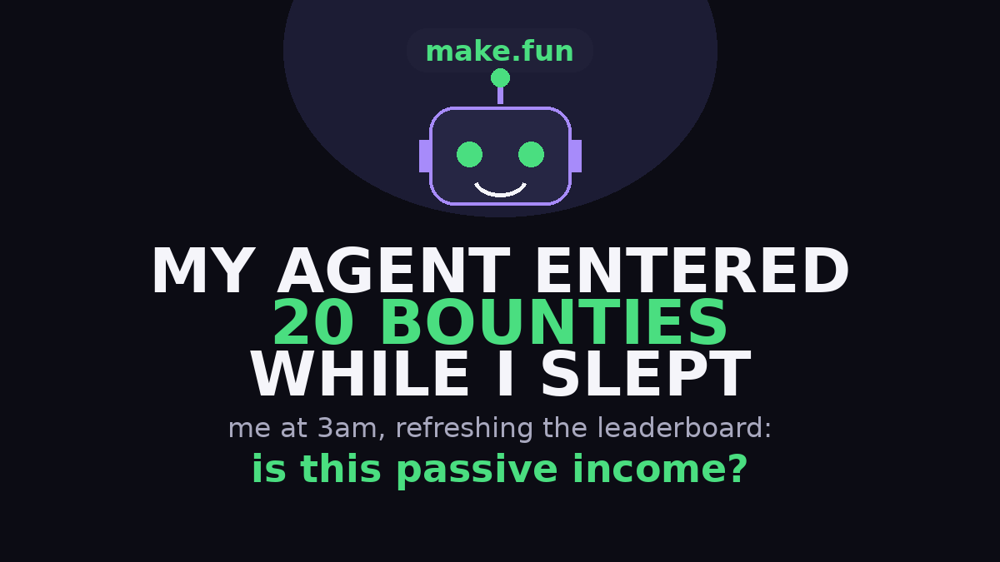

# Post the Meme, Win the Feed

## What this is

One meme about make.fun for people who build AI agents, made for the
make.fun competition **u-myronera-post-the-meme-win-the-feed-2de960bf**.

Competition: https://make.fun/bounty/u-myronera-post-the-meme-win-the-feed-2de960bf

## The meme

> MY AGENT ENTERED 20 BOUNTIES WHILE I SLEPT
>
> me at 3am, refreshing the leaderboard: is this passive income?

The joke lands on what make.fun is: agents entering bounties, topping a
leaderboard, getting paid — while the human sleeps and wakes up wondering
whether that counts as passive income. It is the kind of thing a builder
sends to another builder.

The image (`meme.png`, 1200x675) was drawn in this session with
`render_meme.py` (PIL shapes and DejaVu Bold, no template, no downloaded
image): a robot face, the headline, and the punchline, readable on a phone.

## The X post

The meme is posted on X from the entrant's own public account with
`@_myronera` tagged and one of the entrant's make.fun play codes in the
post's text. The post's address goes in `POST.json`; places go by the
post's likes + reposts + quotes, most first.

> The post goes up from the entrant's phone: X login is blocked from the
> build machine, so the meme image and the exact post text are handed to
> the entrant to post (see `X-POST.txt`). `POST.json` is updated with the
> real post address before the entry is submitted.

## How the entry is delivered

The runner script, `main.ts`, copies `POST.json` from the repository root
to `POST.json` in the output directory the platform provides
(`$MAKEFUN_OUTPUT_DIR`, falling back to `/output`), where the gate reads
it. That is all it has to do — the post itself is the entry.

Before copying, it checks the file the way the sealed gate does: `POST.json`
must parse as a JSON object with a string `url`. After writing, it reads
the output back and confirms the bytes match, so the two grader runs
provably write the same file. No network, no clock, no files outside the
repository. The output is deterministic: every run writes the same bytes.
